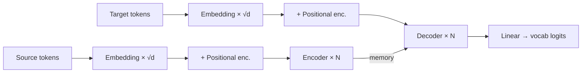

# Transformer from Scratch (PyTorch)

[](https://github.com/Victus0904/Transformers/actions/workflows/ci.yml)


[](LICENSE)

A from-scratch implementation of the encoder–decoder Transformer from
[*Attention Is All You Need*](https://arxiv.org/abs/1706.03762) (Vaswani et al., 2017),
written in plain PyTorch without `nn.Transformer`. Every component is a small,
documented module, and a test suite checks that the masking behaves correctly.

## Architecture



| Component | Class |
|---|---|
| Token embeddings (scaled by √d_model) | `InputEmbeddings` |
| Sinusoidal positional encoding | `PositionalEncoding` |
| Layer normalization | `LayerNormalization` |
| Position-wise feed-forward network | `FeedForwardBlock` |
| Scaled dot-product + multi-head attention | `MultiHeadAttentionBlock` |
| Pre-norm residual connection | `ResidualConnection` |
| Encoder / decoder stacks | `EncoderBlock`, `Encoder`, `DecoderBlock`, `Decoder` |
| Output projection to vocabulary | `ProjectionLayer` |
| Full model + builder with Xavier init | `Transformer`, `build_transformer` |
| Look-ahead mask for the decoder | `causal_mask` |

The defaults of `build_transformer` match the paper's *base* model:
d_model = 512, N = 6, h = 8, d_ff = 2048, dropout = 0.1.

## Usage

```python
import torch
from transformer import build_transformer, causal_mask

model = build_transformer(
    src_vocab_size=10_000, tgt_vocab_size=10_000,
    src_seq_len=128, tgt_seq_len=128,
)

src = torch.randint(0, 10_000, (2, 128))
tgt = torch.randint(0, 10_000, (2, 128))

enc = model.encode(src, src_mask=None)
dec = model.decode(enc, None, tgt, causal_mask(128))
logits = model.project(dec)   # (batch, tgt_seq_len, tgt_vocab_size)
```

**Padding masks:** pass a mask of shape `(batch, 1, 1, src_len)` with `0` at padded
positions as `src_mask`, to both `encode` and `decode`.

## Tests

```bash
pip install -r requirements.txt pytest
pytest -q
```

The suite checks:

- output shapes of the encoder, decoder and projection
- that the **causal mask** stops the decoder from seeing future tokens
- that **padding masks** make the output independent of padded source tokens
- that a few optimizer steps on a toy copy task reduce the loss

## License

[MIT](LICENSE)
